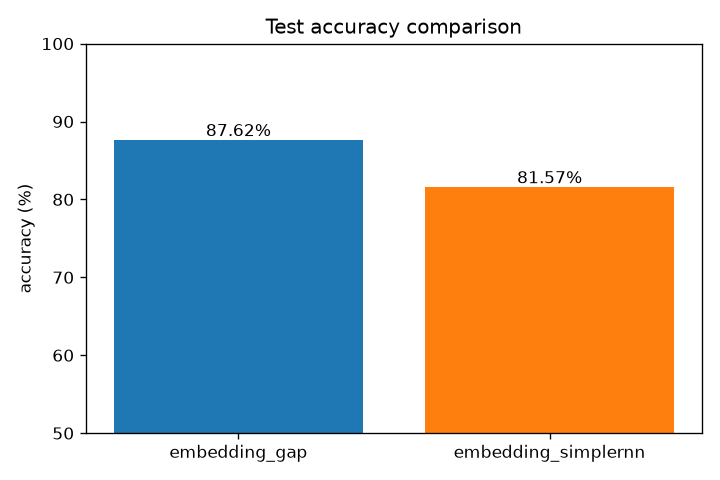
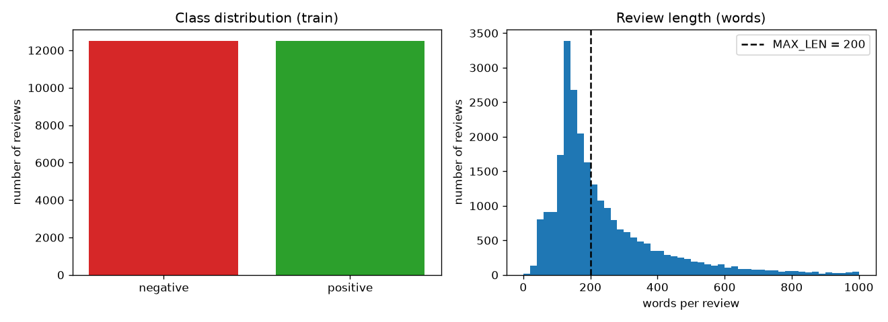
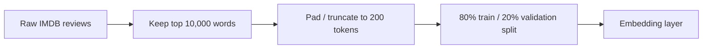
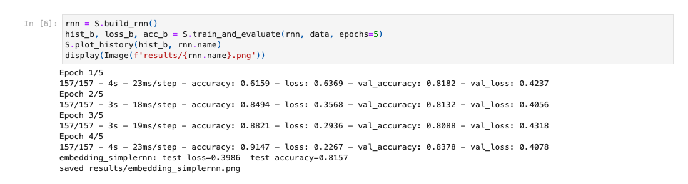
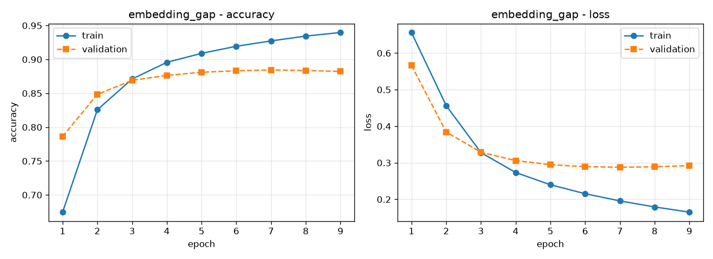
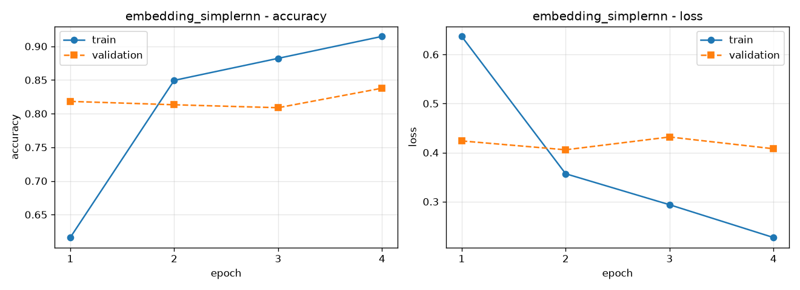
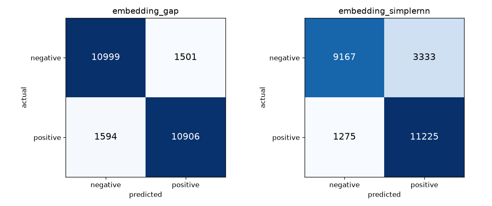
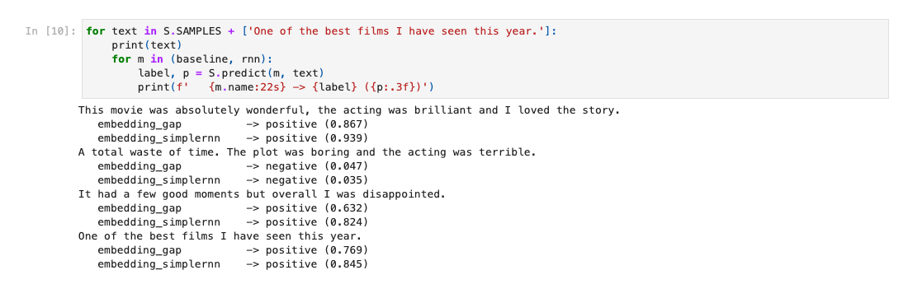

# 🎬 Basic Sentiment Analysis on IMDB Movie Reviews


**Deep Learning Techniques (DLT) Lab Project.** This project classifies movie reviews as **positive** or **negative** using two simple neural networks: a word-embedding baseline and a SimpleRNN.

<p align="center">
  
</p>

---

## 📑 Table of Contents

1. [Aim](#-aim)
2. [Dataset](#-dataset)
3. [Preprocessing](#-preprocessing)
4. [Model Architectures](#-model-architectures)
5. [Training](#-training)
6. [Results](#-results)
7. [Predicting Custom Reviews](#-predicting-custom-reviews)
8. [How to Run](#-how-to-run)
9. [Project Structure](#-project-structure)
10. [Conclusion](#-conclusion)

---

## 🎯 Aim

To build, train and compare two basic deep learning models that classify IMDB movie reviews as positive or negative:

- **(a)** Embedding + GlobalAveragePooling (baseline)
- **(b)** Embedding + SimpleRNN

## 📊 Dataset

The built-in [`keras.datasets.imdb`](https://keras.io/api/datasets/imdb/) dataset:

| Property | Value |
|---|---|
| Total reviews | 50,000 |
| Training set | 25,000 |
| Test set | 25,000 |
| Classes | 0 = negative, 1 = positive |
| Class balance | 50% / 50% |
| Format | Each review is a sequence of word indices (already tokenised) |



The two classes are perfectly balanced, so accuracy is a fair metric. Review length varies a lot. The median is **178 words**, and a few reviews are over 1,000 words long.

## ⚙️ Preprocessing



1. **Vocabulary limit:** keep the 10,000 most frequent words (`num_words=10000`). Rarer words become an "unknown" token.
2. **Padding:** `pad_sequences(maxlen=200)` makes every review exactly 200 tokens long. Shorter reviews are padded with zeros at the front. Longer reviews (about 43% of them) keep only their last 200 words.
3. **Validation split:** 20% of the training set is held out to monitor overfitting.

## 🧠 Model Architectures

### (a) Embedding + GlobalAveragePooling (baseline)

Each word is turned into a 32-dimensional vector, and all the vectors in a review are **averaged**. Word order is ignored, so the model works like a smart "bag of words".

| Layer | Output Shape | Parameters |
|---|---|---|
| Embedding(10000, 32) | (200, 32) | 320,000 |
| GlobalAveragePooling1D | (32) | 0 |
| Dense(16, ReLU) | (16) | 528 |
| Dense(1, Sigmoid) | (1) | 17 |
| **Total** | | **320,545** |

### (b) Embedding + SimpleRNN

The SimpleRNN reads the review **one word at a time** and updates a 32-unit hidden state. Its final state is used to classify the review.

| Layer | Output Shape | Parameters |
|---|---|---|
| Embedding(10000, 32) | (200, 32) | 320,000 |
| SimpleRNN(32) | (32) | 2,080 |
| Dense(1, Sigmoid) | (1) | 33 |
| **Total** | | **322,113** |

## 🏋️ Training

| Setting | Value |
|---|---|
| Optimizer | Adam |
| Loss | Binary cross-entropy |
| Batch size | 128 |
| Max epochs | 10 (baseline), 5 (SimpleRNN) |
| Early stopping | Monitors `val_loss`, patience 2, restores the best weights |

Training log of the SimpleRNN from the notebook. Early stopping ended training after epoch 4 and restored the best weights (epoch 2):



### Accuracy and loss curves

**(a) Embedding + GlobalAveragePooling**



**(b) Embedding + SimpleRNN**



The baseline's training and validation curves stay close together. The SimpleRNN's training accuracy keeps rising while its validation accuracy stays flat, which is a clear sign of **overfitting**.

## 📈 Results

Evaluated on the 25,000 unseen test reviews:

| Model | Parameters | Test Loss | Test Accuracy | Precision | Recall |
|---|---|---|---|---|---|
| Embedding + GlobalAveragePooling | 320,545 | 0.2949 | **87.62%** | 87.9% | 87.2% |
| Embedding + SimpleRNN | 322,113 | 0.3986 | 81.57% | 77.1% | 89.8% |

*(Precision and recall are for the positive class. Results vary by a few percent between runs because of random weight initialisation.)*

### Confusion matrices



- The **baseline** makes about the same number of mistakes in both directions (1,501 vs 1,594).
- The **SimpleRNN** leans toward predicting *positive*. It labels 3,333 negative reviews as positive, which explains its lower precision but higher recall.

## 💬 Predicting Custom Reviews

The `predict()` function converts raw text into word indices using the IMDB word index (the same encoding as the dataset) and returns a label and a probability:



Both models handle clearly positive and clearly negative reviews correctly. Both models get the mixed review *"It had a few good moments but overall I was disappointed."* wrong. They pick up on "good moments" and don't understand that "but overall … disappointed" changes the meaning.

## 🚀 How to Run

**1. Clone and set up the environment** (Python 3.12, because TensorFlow does not support newer versions yet)

```bash
git clone https://github.com/jsuryacodes/DLT-Sentiment-Analysis.git
cd DLT-Sentiment-Analysis
python3.12 -m venv venv
source venv/bin/activate
pip install -r requirements.txt
```

**2a. Run the script.** It trains both models, saves all plots to `results/` and prints the predictions:

```bash
python sentiment_rnn.py
```

**2b. Or open the notebook** to go through it step by step:

```bash
jupyter notebook sentiment_analysis.ipynb
```

**3. Classify your own review:**

```python
import sentiment_rnn as S

data = S.load_data()
model = S.build_baseline()
S.train_and_evaluate(model, data, epochs=10)
print(S.predict(model, "Great movie, I enjoyed it a lot!"))   # ('positive', 0.9...)
```

On a laptop CPU, the baseline trains in a few seconds and the SimpleRNN in under a minute.

## 📁 Project Structure

```
DLT-Sentiment-Analysis/
├── sentiment_rnn.py           # data loading, models, training, plots, predict()
├── sentiment_analysis.ipynb   # executed notebook with all outputs
├── requirements.txt           # Python dependencies
├── results/
│   ├── data_overview.png        # class balance + review length histogram
│   ├── embedding_gap.png        # baseline accuracy/loss curves
│   ├── embedding_simplernn.png  # SimpleRNN accuracy/loss curves
│   ├── model_comparison.png     # test accuracy bar chart
│   └── confusion_matrices.png   # confusion matrices for both models
└── screenshots/
    ├── rnn_training.png         # notebook training log
    └── custom_predictions.png   # notebook prediction output
```

## ✅ Conclusion

- Both models learned to classify movie review sentiment from scratch using only the review text.
- The simple **Embedding + GlobalAveragePooling** model performed best (**87.6%**). It beat the SimpleRNN (**81.6%**) and also trained several times faster.
- This works because most of the sentiment in a review comes from individual words like *"brilliant"*, *"terrible"* and *"waste"*, so averaging the word vectors is enough.
- The **SimpleRNN** overfit after 2–3 epochs. It also has trouble carrying information across 200 time steps because of the **vanishing gradient** problem.
- Both models struggle with mixed reviews where words like "but" change the meaning.
- **Future work:** replace SimpleRNN with **LSTM/GRU** layers, use pre-trained embeddings (e.g. GloVe), or add dropout to reduce overfitting.
